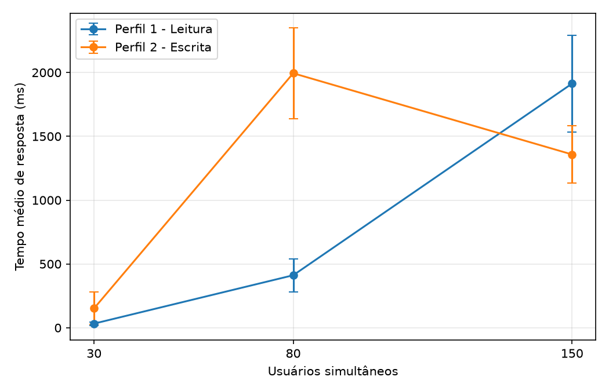
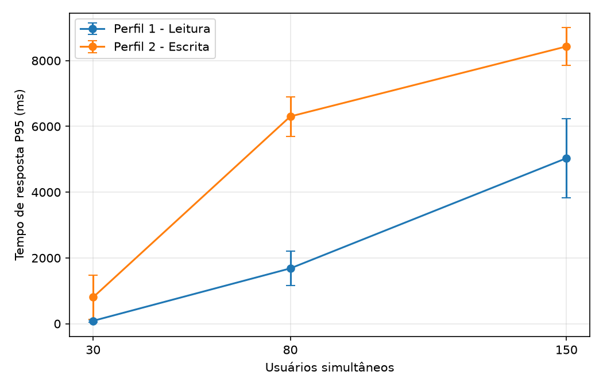
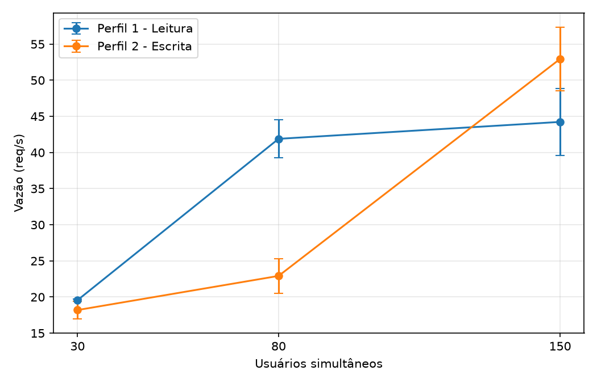
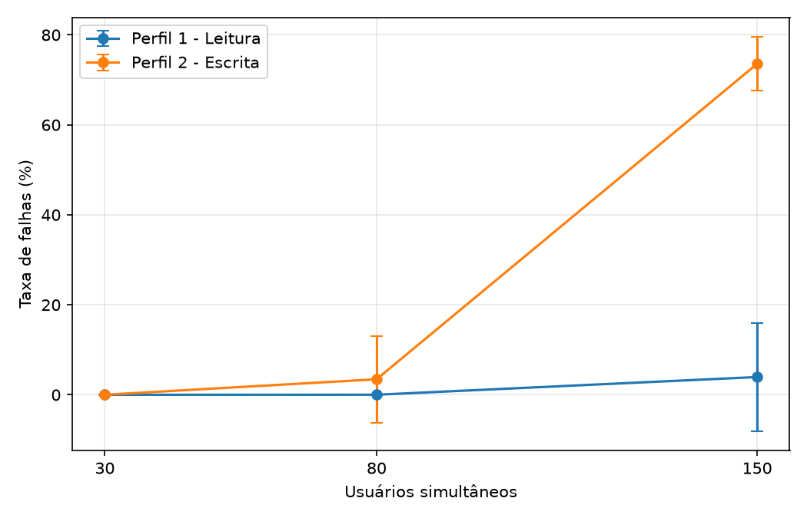
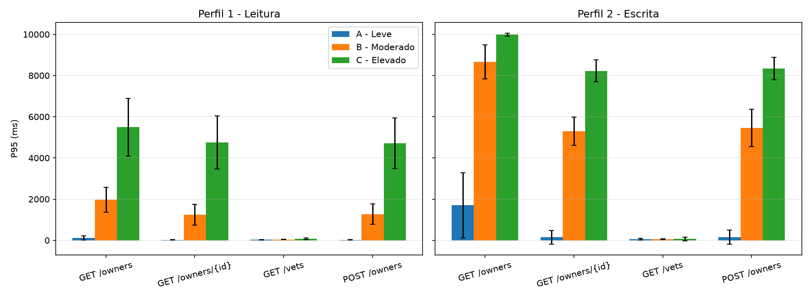
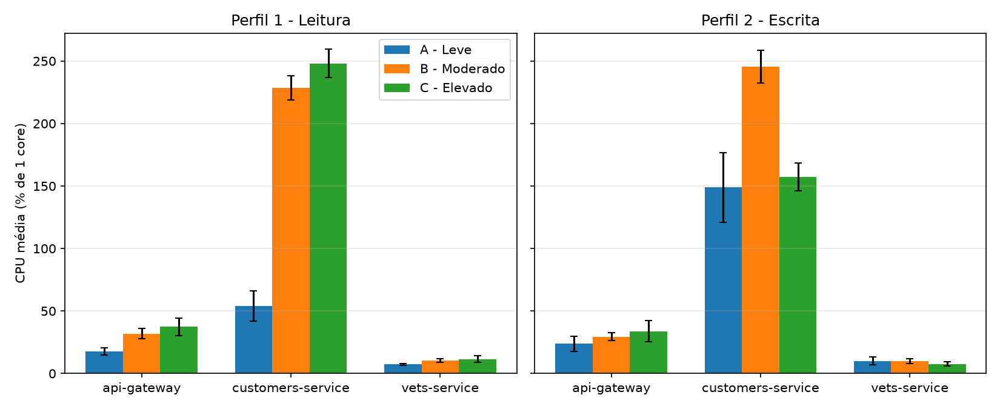
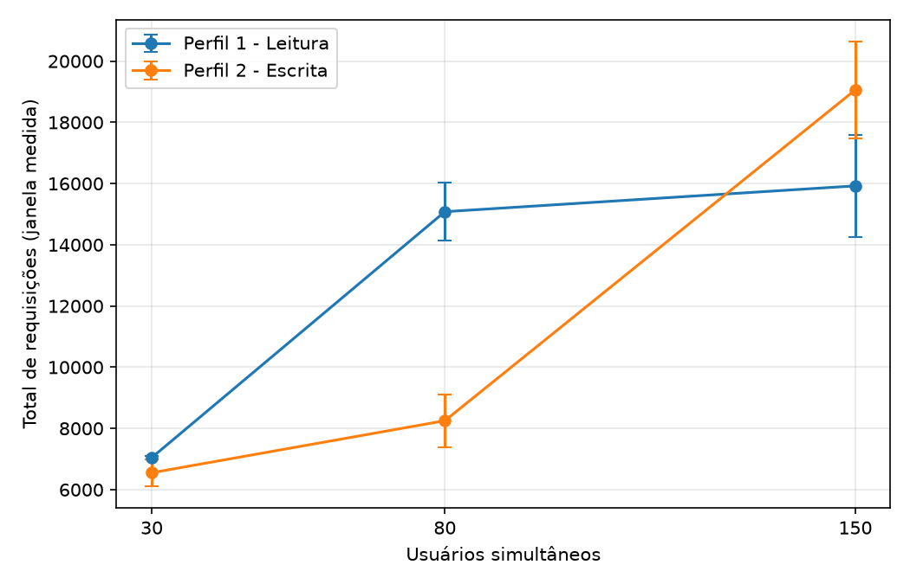
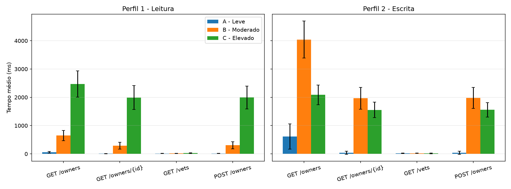

# Trabalho 06 — Avaliação de Desempenho de Microsserviços com Locust

Avaliação do Spring PetClinic Microservices sob dois perfis de carga (leitura e escrita) e três cenários (30, 80 e 150 usuários).

**Vídeo demonstrativo:** <COLE_AQUI_O_LINK_DO_YOUTUBE>

## 1. Ambiente
**Host (Windows):** Intel(R) Core(TM) i5-8365U CPU @ 1.60GHz; 16 GB de RAM. Experimentos executados em Ubuntu sobre WSL2 com Docker, gerador de carga (Locust) e aplicação na mesma máquina.

Detalhes coletados por `scripts/collect_env.sh` (`results/environment.txt`):

```text
# Ambiente - coletado em 2026-10-21T19:48:42-03:00
## SO
Distributor ID:	Ubuntu
Description:	Ubuntu 26.04 LTS
Release:	26.04
Codename:	resolute
Linux DESKTOP-6957GJJ 6.6.114.1-microsoft-standard-WSL2 #1 SMP PREEMPT_DYNAMIC Mon Dec  1 20:46:23 UTC 2025 x86_64 GNU/Linux
## CPU
CPU(s):                                  4
Model name:                              Intel(R) Core(TM) i5-8365U CPU @ 1.60GHz
Thread(s) per core:                      2
Core(s) per socket:                      2
## Memoria (WSL)
               total        used        free      shared  buff/cache   available
Mem:           7.8Gi       3.8Gi       215Mi        21Mi       3.9Gi       3.9Gi
Swap:          2.0Gi       1.0Mi       2.0Gi
## Docker
Client 29.9.1 / Server 29.9.1
Docker Compose version v5.6.0
## Python / Locust
Python 3.14.4
locust 2.46.7 from /home/lucas/trabalho06-locust-petclinic/.venv/lib/python3.14/site-packages/locust (Python 3.14.4)
## PetClinic (commit)
1d76b00d683e86b62867a6bf59530f8ab301244f Wed Oct 7 19:01:35 2026 +0200
## Containers
NAMES               IMAGE                                                STATUS
admin-server        springcommunity/spring-petclinic-admin-server        Up 10 hours
vets-service        springcommunity/spring-petclinic-vets-service        Up 30 minutes
api-gateway         springcommunity/spring-petclinic-api-gateway         Up 30 minutes
visits-service      springcommunity/spring-petclinic-visits-service      Up 30 minutes
customers-service   springcommunity/spring-petclinic-customers-service   Up 30 minutes
discovery-server    springcommunity/spring-petclinic-discovery-server    Up 10 hours (healthy)
config-server       springcommunity/spring-petclinic-config-server       Up 10 hours (healthy)
grafana-server      spring-petclinic-microservices-grafana-server        Up 10 hours
prometheus-server   spring-petclinic-microservices-prometheus-server     Up 10 hours
tracing-server      openzipkin/zipkin                                    Up 10 hours (healthy)
## Limite de memoria (bytes) por container
/admin-server mem_limit=536870912
/vets-service mem_limit=536870912
/api-gateway mem_limit=536870912
/visits-service mem_limit=536870912
/customers-service mem_limit=536870912
/discovery-server mem_limit=536870912
/config-server mem_limit=536870912
/grafana-server mem_limit=268435456
/prometheus-server mem_limit=268435456
/tracing-server mem_limit=536870912
```

## 2. Como reproduzir
```bash
git clone https://github.com/spring-petclinic/spring-petclinic-microservices.git ~/spring-petclinic-microservices
cd ~/spring-petclinic-microservices && git checkout 1d76b00d683e86b62867a6bf59530f8ab301244f
docker compose up -d config-server discovery-server customers-service visits-service vets-service api-gateway tracing-server admin-server prometheus-server grafana-server

git clone https://github.com/Lucaspm5/trabalho06-locust-petclinic.git && cd trabalho06-locust-petclinic
python3 -m venv .venv && source .venv/bin/activate
pip install -r requirements.txt
chmod +x scripts/*.sh
./scripts/run_all.sh        # 60 execuções (~9 h)
python scripts/analyze.py   # gera tabelas e gráficos em results/
```

### Estrutura do repositório

```text
.
├── locustfile.py            # perfis ReadProfileUser e WriteProfileUser
├── requirements.txt
├── scripts/                 # env.sh, wait_ready.sh, monitor_cpu.sh, run_all.sh, collect_env.sh, analyze.py
└── results/
    ├── raw/                 # *_cpu.csv (docker stats) e *_locust_*.csv (estatísticas nativas do Locust, incluem aquecimento)
    ├── raw_requests.tar.gz  # log por requisição das 60 execuções
    ├── summary_*.csv        # métricas por execução, por cenário, por operação e CPU
    ├── tables.md            # tabelas consolidadas
    ├── failures_by_status.csv
    ├── environment.txt, run_all.log
    └── graphs/              # gráficos (PNG)
```

Para reprocessar sem reexecutar os experimentos:

```bash
mkdir -p results/raw && tar xzf results/raw_requests.tar.gz -C results/raw
python scripts/analyze.py
```

## 3. Metodologia
- Perfis: `ReadProfileUser` (45/35/15/5) e `WriteProfileUser` (20/20/20/40) em `locustfile.py`.
- Endpoints (via API Gateway, porta 8080): `/api/customer/owners`, `/api/customer/owners/{id}`, `/api/vet/vets`.
- Cenários: A=30, B=80, C=150 usuários; ramp-up de 5 usuários/s; think time 1–2 s.
- Cada execução: 1 min de aquecimento (descartado) + 6 min medidos. 10 repetições por configuração (60 execuções).
- Entre execuções, customers, vets, visits e gateway são reiniciados (banco HSQLDB em memória volta ao estado inicial).
- Métricas calculadas sobre o log por requisição (`results/raw`), apenas na janela medida. Resultado = média das 10 repetições (± desvio padrão).
- CPU: `docker stats` a cada ~2 s; média na janela medida (100% = 1 core).
- Falha = status HTTP diferente de 200/201 ou erro de conexão/timeout.
- Interpretação do enunciado: cada execução dura 7 min (1 min de aquecimento descartado + 6 min medidos).
- Tempo médio e P95 consideram todas as requisições da janela medida, inclusive as com falha.
- A média das repetições é a média aritmética das métricas de cada execução (inclusive do P95).
- As configurações são intercaladas (repetição 1 de todas, depois repetição 2, etc.) para diluir efeitos de deriva do ambiente.

## 4. Resultados
Valores: média ± desvio padrão das 10 repetições, na janela medida (sem aquecimento).

### 1. Visão geral por perfil e cenário

| Perfil             | Cenário      |   Usuários |   Reps | Tempo médio (ms)   | P95 (ms)        | Vazão (req/s)   | Total de req.   | Falhas (%)   |
|:-------------------|:-------------|-----------:|-------:|:-------------------|:----------------|:----------------|:----------------|:-------------|
| Perfil 1 - Leitura | A - Leve     |         30 |     10 | 32.5 ± 13.2        | 87.3 ± 34.2     | 19.57 ± 0.15    | 7044 ± 55       | 0.00 ± 0.00  |
| Perfil 1 - Leitura | B - Moderado |         80 |     10 | 411.5 ± 129.7      | 1682.6 ± 526.6  | 41.89 ± 2.65    | 15081 ± 955     | 0.01 ± 0.04  |
| Perfil 1 - Leitura | C - Elevado  |        150 |     10 | 1913.1 ± 378.7     | 5032.5 ± 1199.6 | 44.23 ± 4.62    | 15924 ± 1664    | 3.95 ± 11.98 |
| Perfil 2 - Escrita | A - Leve     |         30 |     10 | 151.8 ± 126.7      | 804.1 ± 670.3   | 18.20 ± 1.19    | 6551 ± 428      | 0.01 ± 0.04  |
| Perfil 2 - Escrita | B - Moderado |         80 |     10 | 1994.3 ± 355.3     | 6302.6 ± 602.4  | 22.92 ± 2.41    | 8252 ± 868      | 3.45 ± 9.61  |
| Perfil 2 - Escrita | C - Elevado  |        150 |     10 | 1358.1 ± 224.0     | 8430.6 ± 572.9  | 52.95 ± 4.37    | 19061 ± 1575    | 73.55 ± 5.98 |


### 2. Por operação

| Perfil             | Cenário      | Operação         | Tempo médio (ms)   | P95 (ms)        | Falhas (%)   |
|:-------------------|:-------------|:-----------------|:-------------------|:----------------|:-------------|
| Perfil 1 - Leitura | A - Leve     | GET /owners      | 57.5 ± 24.6        | 124.0 ± 100.5   | 0.00 ± 0.00  |
| Perfil 1 - Leitura | A - Leve     | GET /owners/{id} | 9.9 ± 3.5          | 19.1 ± 8.1      | 0.00 ± 0.00  |
| Perfil 1 - Leitura | A - Leve     | GET /vets        | 15.4 ± 3.8         | 30.4 ± 9.9      | 0.00 ± 0.00  |
| Perfil 1 - Leitura | A - Leve     | POST /owners     | 12.2 ± 4.2         | 23.0 ± 10.7     | 0.00 ± 0.00  |
| Perfil 1 - Leitura | B - Moderado | GET /owners      | 648.2 ± 181.5      | 1971.2 ± 604.6  | 0.03 ± 0.07  |
| Perfil 1 - Leitura | B - Moderado | GET /owners/{id} | 291.6 ± 123.1      | 1249.0 ± 504.5  | 0.01 ± 0.02  |
| Perfil 1 - Leitura | B - Moderado | GET /vets        | 19.7 ± 5.0         | 41.5 ± 15.4     | 0.00 ± 0.00  |
| Perfil 1 - Leitura | B - Moderado | POST /owners     | 304.5 ± 125.3      | 1272.2 ± 499.4  | 0.00 ± 0.00  |
| Perfil 1 - Leitura | C - Elevado  | GET /owners      | 2469.3 ± 461.5     | 5494.5 ± 1399.7 | 4.02 ± 11.99 |
| Perfil 1 - Leitura | C - Elevado  | GET /owners/{id} | 1991.3 ± 423.9     | 4757.2 ± 1287.5 | 3.89 ± 11.90 |
| Perfil 1 - Leitura | C - Elevado  | GET /vets        | 26.3 ± 10.8        | 67.2 ± 40.0     | 3.67 ± 11.60 |
| Perfil 1 - Leitura | C - Elevado  | POST /owners     | 1993.2 ± 401.2     | 4714.8 ± 1224.9 | 4.51 ± 13.58 |
| Perfil 2 - Escrita | A - Leve     | GET /owners      | 617.2 ± 445.5      | 1698.9 ± 1575.1 | 0.06 ± 0.17  |
| Perfil 2 - Escrita | A - Leve     | GET /owners/{id} | 36.1 ± 54.3        | 147.8 ± 334.4   | 0.00 ± 0.00  |
| Perfil 2 - Escrita | A - Leve     | GET /vets        | 21.7 ± 11.9        | 50.0 ± 36.5     | 0.00 ± 0.00  |
| Perfil 2 - Escrita | A - Leve     | POST /owners     | 38.8 ± 57.4        | 153.8 ± 344.3   | 0.00 ± 0.00  |
| Perfil 2 - Escrita | B - Moderado | GET /owners      | 4041.4 ± 656.9     | 8658.7 ± 825.0  | 5.09 ± 11.20 |
| Perfil 2 - Escrita | B - Moderado | GET /owners/{id} | 1968.1 ± 384.3     | 5296.2 ± 677.5  | 3.10 ± 9.30  |
| Perfil 2 - Escrita | B - Moderado | GET /vets        | 24.6 ± 7.9         | 54.7 ± 20.4     | 2.73 ± 8.63  |
| Perfil 2 - Escrita | B - Moderado | POST /owners     | 1976.8 ± 370.3     | 5457.4 ± 905.5  | 3.16 ± 9.54  |
| Perfil 2 - Escrita | C - Elevado  | GET /owners      | 2088.4 ± 348.2     | 9984.8 ± 69.3   | 76.42 ± 5.62 |
| Perfil 2 - Escrita | C - Elevado  | GET /owners/{id} | 1555.1 ± 274.8     | 8225.5 ± 535.7  | 73.38 ± 6.02 |
| Perfil 2 - Escrita | C - Elevado  | GET /vets        | 17.0 ± 16.0        | 66.8 ± 85.4     | 70.88 ± 5.94 |
| Perfil 2 - Escrita | C - Elevado  | POST /owners     | 1556.6 ± 251.6     | 8335.8 ± 540.6  | 73.52 ± 6.26 |


### 3. Degradação por operação (tempo médio no cenário C ÷ cenário A)

| Perfil             | Operação         |   Razão C/A (tempo médio) |
|:-------------------|:-----------------|--------------------------:|
| Perfil 1 - Leitura | GET /owners      |                     42.96 |
| Perfil 1 - Leitura | GET /owners/{id} |                    200.58 |
| Perfil 1 - Leitura | GET /vets        |                      1.71 |
| Perfil 1 - Leitura | POST /owners     |                    163.38 |
| Perfil 2 - Escrita | GET /owners      |                      3.38 |
| Perfil 2 - Escrita | GET /owners/{id} |                     43.04 |
| Perfil 2 - Escrita | GET /vets        |                      0.79 |
| Perfil 2 - Escrita | POST /owners     |                     40.12 |


### 4. CPU média por serviço

| Perfil             | Cenário      | Serviço           | CPU média (% de 1 core)   |
|:-------------------|:-------------|:------------------|:--------------------------|
| Perfil 1 - Leitura | A - Leve     | api-gateway       | 17.8 ± 2.9                |
| Perfil 1 - Leitura | A - Leve     | customers-service | 53.9 ± 12.2               |
| Perfil 1 - Leitura | A - Leve     | vets-service      | 7.3 ± 0.9                 |
| Perfil 1 - Leitura | B - Moderado | api-gateway       | 31.8 ± 4.1                |
| Perfil 1 - Leitura | B - Moderado | customers-service | 228.5 ± 9.6               |
| Perfil 1 - Leitura | B - Moderado | vets-service      | 10.4 ± 1.5                |
| Perfil 1 - Leitura | C - Elevado  | api-gateway       | 37.5 ± 7.0                |
| Perfil 1 - Leitura | C - Elevado  | customers-service | 248.0 ± 11.4              |
| Perfil 1 - Leitura | C - Elevado  | vets-service      | 11.5 ± 2.8                |
| Perfil 2 - Escrita | A - Leve     | api-gateway       | 23.7 ± 5.8                |
| Perfil 2 - Escrita | A - Leve     | customers-service | 148.9 ± 27.9              |
| Perfil 2 - Escrita | A - Leve     | vets-service      | 10.0 ± 3.1                |
| Perfil 2 - Escrita | B - Moderado | api-gateway       | 29.5 ± 3.1                |
| Perfil 2 - Escrita | B - Moderado | customers-service | 245.7 ± 13.2              |
| Perfil 2 - Escrita | B - Moderado | vets-service      | 9.9 ± 2.1                 |
| Perfil 2 - Escrita | C - Elevado  | api-gateway       | 33.8 ± 8.4                |
| Perfil 2 - Escrita | C - Elevado  | customers-service | 157.2 ± 11.2              |
| Perfil 2 - Escrita | C - Elevado  | vets-service      | 7.7 ± 1.7                 |


### 5. Falhas por status HTTP (0 = erro de conexão/timeout)

| Perfil             | Cenário   | Operação         |   HTTP status |   Falhas (soma das reps) |
|:-------------------|:----------|:-----------------|--------------:|-------------------------:|
| Perfil 1 - Leitura | B         | GET /owners      |           405 |                       15 |
| Perfil 1 - Leitura | B         | GET /owners/{id} |           405 |                        3 |
| Perfil 1 - Leitura | C         | GET /owners      |           405 |                     2725 |
| Perfil 1 - Leitura | C         | GET /owners/{id} |           405 |                     2069 |
| Perfil 1 - Leitura | C         | GET /vets        |           405 |                      817 |
| Perfil 1 - Leitura | C         | POST /owners     |           503 |                      352 |
| Perfil 2 - Escrita | A         | GET /owners      |           405 |                        6 |
| Perfil 2 - Escrita | B         | GET /owners      |           405 |                      951 |
| Perfil 2 - Escrita | B         | GET /owners/{id} |           405 |                      638 |
| Perfil 2 - Escrita | B         | GET /vets        |           405 |                      574 |
| Perfil 2 - Escrita | B         | POST /owners     |           503 |                     1289 |
| Perfil 2 - Escrita | C         | GET /owners      |           405 |                    29443 |
| Perfil 2 - Escrita | C         | GET /owners/{id} |           405 |                    28166 |
| Perfil 2 - Escrita | C         | GET /vets        |           405 |                    26953 |
| Perfil 2 - Escrita | C         | POST /owners     |           503 |                    56376 |

### Gráficos










## 5. Respostas
1. Efeito do aumento de usuários no tempo de resposta: ...
2. Perfil com maior vazão: ...
3. Operações com maior degradação: ...
4. Variação do consumo de CPU: ...
5. Cenário com maior taxa de falhas: ...

## 6. Conclusões e limitações
- Gerador de carga e aplicação compartilham a mesma máquina.
- Containers limitados a 512 MB (definido no docker-compose do PetClinic).
- `GET /owners` retorna todos os owners; no perfil de escrita a lista cresce durante a execução.
